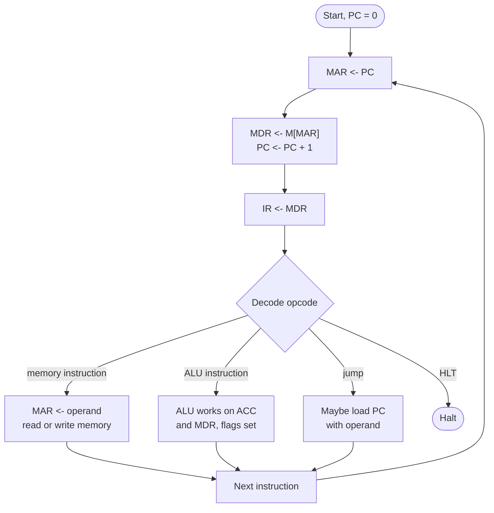

# CPU Instruction Cycle Simulator

Computer Organization and Architecture (SY CSE), CO5 micro project. Department of Integrated B.Tech, Sanjivani University, Kopargaon.

Topic from the notice: **1. CPU instruction cycle (fetch, decode, execute)**

| Name | PRN |
|---|---|
| Prasad Sudhir Thorat | 2125UIDM1002 |
| Vaishnavi Subhash Shedke | 2125UIDF1073 |


## What it does

A small accumulator CPU that you can watch working one **micro-operation** at a time. You write a short assembly program (or pick one of the samples), load it into memory, and step through it. For every step the page shows which registers changed, which blocks of the CPU are active in the block diagram, what the control unit is doing in plain words, and how many clock cycles have been used.

The machine used here:

* 16-bit words. An instruction word is 8 bits of opcode followed by 8 bits of operand.
* Registers: PC, MAR, MDR, IR, ACC. Flags: Z (zero), N (negative), C (carry/borrow).
* Memory of 16, 32, 64 or 128 words that you choose.

| Opcode | Mnemonic | Effect |
|---|---|---|
| 00 | NOP | do nothing |
| 01 | HLT | stop the CPU |
| 02 | LDI n | ACC <- n |
| 03 | LOAD a | ACC <- M[a] |
| 04 | STORE a | M[a] <- ACC |
| 05 | ADD a | ACC <- ACC + M[a] |
| 06 | SUB a | ACC <- ACC - M[a] |
| 07 | INC | ACC <- ACC + 1 |
| 08 | DEC | ACC <- ACC - 1 |
| 09 | JMP a | PC <- a |
| 0A | JZ a | if Z = 1 then PC <- a |
| 0B | JNZ a | if Z = 0 then PC <- a |
| 0C | OUT | send ACC to the output port |

Assembly syntax: one instruction per line, optional `label:` in front, `DB value` to place a data word, `;` starts a comment.

## The cycle that is being simulated

Every instruction goes through the same three phases.

| Phase | Micro-operations |
|---|---|
| Fetch | `MAR <- PC`, then `MDR <- M[MAR]` and `PC <- PC + 1`, then `IR <- MDR` |
| Decode | the control unit splits IR into opcode and operand and picks the execute steps |
| Execute | depends on the instruction, for example LOAD is `MAR <- operand`, `MDR <- M[MAR]`, `ACC <- MDR` |



## Things you can change

* **Memory size** (16 to 128 words).
* **Memory access time** (1 to 4 clock cycles). Every memory read or write costs that many cycles, so a slow memory makes the same program take more cycles while the answer stays identical. The cycle counter and the cycles-per-instruction figure show this directly.
* **Number format**: decimal, hex or binary.
* **The program itself**, edited in the text box and loaded with *Assemble & load*. Syntax errors are listed with line numbers.
* Run speed for the automatic *Run* button.

Three ways to move forward: **Step micro-operation**, **Step instruction** (one whole fetch-decode-execute), or **Run**.

## Sample programs included

Add two numbers, sum of 1 to 5 using a loop, multiply 6 x 7 by repeated addition, countdown from 3 to 0. Each prints its result on the output port.

## Files

```
index.html     page layout
style.css      styling
cpu.js         the CPU, assembler and sample programs (no browser code in it)
app.js         connects cpu.js to the page
tests/cpu.test.js   automatic checks
```

## Questions you may be asked, with short answers

**Why does PC already point to the next instruction while the current one is still executing?** PC is incremented in the second fetch step, at the same time the word is read from memory. Jumps then overwrite it during execute.

**What is the difference between MAR and MDR?** MAR holds the address being accessed, MDR holds the data going to or coming from that address.

**Which phase uses the ALU?** Only the execute phase of ADD, SUB, INC and DEC. Fetch and decode never touch it.

**Why do LOAD and ADD take more cycles than LDI?** They need a second memory access for the operand, on top of the memory access used to fetch the instruction itself.

**How does JZ decide?** It looks at the Z flag, which was set by the last instruction that changed ACC.

**What happens if memory is made slower?** Each memory step costs more cycles. Fetch always has one, LOAD/STORE/ADD/SUB have a second.

## Assumptions

Instruction and data share one memory (von Neumann style). The operand field is 8 bits, so addresses and immediate values go from 0 to 255. Flags are updated by LDI, LOAD, ADD, SUB, INC and DEC; STORE and jumps leave them alone.
## Running it on your own computer

Open `index.html` in any modern browser. Nothing has to be installed and nothing is uploaded anywhere. If your browser blocks something when opening the file directly, run `python3 -m http.server` inside this folder and open `http://localhost:8000`.

To run the automated checks you need Node.js (version 16 or newer): `node tests/cpu.test.js`

## Putting it on GitHub

1. Create a new **public** repository on github.com (for example `coa-cpu-instruction-cycle`). Do not tick "Add a README", you already have one.
2. Upload everything in this folder: on the empty repository page choose **uploading an existing file**, drag all the files and the `tests` folder in, and commit. (Or use `git init`, `git add .`, `git commit`, `git remote add origin ...`, `git push -u origin main` from this folder.)
3. In the repository go to **Settings, then Pages**. Under *Build and deployment* set **Source** to *Deploy from a branch*, pick the `main` branch and the `/ (root)` folder, and save.
4. After a minute or two the simulator is live at `https://<your-github-username>.github.io/coa-cpu-instruction-cycle/`. Put that link at the top of this README and in the Google Form.

GitHub's menu labels change from time to time, so if a name above does not match, look for the Pages section under Settings.
